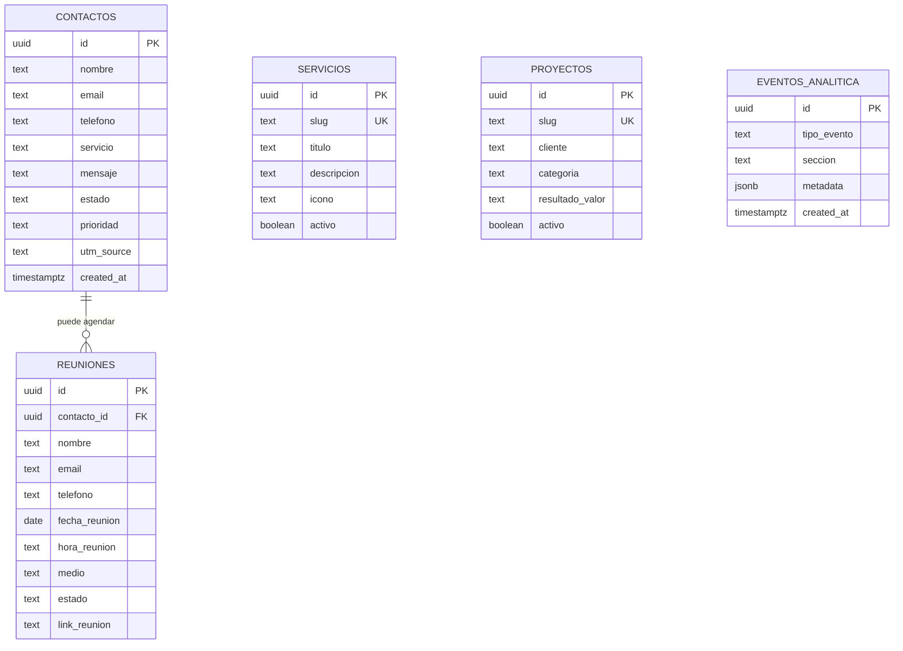

# 🛠️ Supabase — Guía de Configuración y Diccionario de Datos

> **Documento Oficial de Base de Datos para Saikora**  
> **Roles:** Data Analyst & Web Management  
> **Motor:** PostgreSQL (Supabase BaaS)  
> **Script SQL principal:** [`supabase/schema.sql`](file:///c:/Users/santi/OneDrive/Desktop/Saikora%20Pagina/supabase/schema.sql)

---

## 🚀 Pasos de Configuración Rápida (5 Minutos)

1. Ingresa a tu panel en [supabase.com](https://supabase.com) e inicia sesión o crea tu proyecto (ej: `saikora-web-db`).
2. En el menú lateral izquierdo, entra a **Project Settings** > **API**.
3. Copia las siguientes credenciales en tu archivo `.env.local` en la raíz de tu proyecto:

```env
# URL de tu instancia Supabase
NEXT_PUBLIC_SUPABASE_URL=https://xxxxxxxxxxxxxxxxxxxx.supabase.co

# Llave anónima pública (para clientes frontend)
NEXT_PUBLIC_SUPABASE_ANON_KEY=eyJhbGciOi...

# Llave de rol de servicio PRIVADA (Servidor/API - NUNCA exponer en cliente)
SUPABASE_SERVICE_ROLE_KEY=eyJhbGciOi...
```

4. En el panel de Supabase, ve a la sección **SQL Editor** (icono `</>`).
5. Abre el archivo [`supabase/schema.sql`](file:///c:/Users/santi/OneDrive/Desktop/Saikora%20Pagina/supabase/schema.sql), copia todo su contenido, pégalo en el editor y presiona **RUN**.
6. ¡Listo! Todas las tablas, políticas de seguridad RLS, índices, triggers y vistas analíticas quedarán automáticamente desplegadas.

---

## 📊 Arquitectura de Base de Datos (Data Analyst & Web Management)

El diseño está optimizado para dos objetivos complementarios:
- **Web Management (Operaciones y CRM):** Control de estados de leads (`nuevo` → `contactado` → `ganado`), agendamiento de reuniones con enlaces directos, catálogo dinámico de servicios y portafolio.
- **Data Analyst (Métricas y Atribución):** Medición de canales de procedencia (parámetros UTM), tasas de conversión por servicio, embudo de reuniones agendadas vs completadas vs *no-shows*, y registro de eventos clave sin vulnerar la privacidad de los usuarios.



---

## 📑 Diccionario de Tablas

### 1. `contactos` (Prospectos y Cotizaciones)
Captura solicitudes recibidas a través del formulario principal de contacto.
- `id` (UUID): Identificador único autogenerado.
- `nombre` (TEXT): Nombre completo o empresa.
- `email` (TEXT): Correo electrónico del prospecto (normalizado a minúsculas).
- `telefono` (TEXT, Opcional): Número de teléfono o WhatsApp.
- `servicio` (TEXT): Solución de interés (`desarrollo-web`, `automatizacion`, `sistema-medida`, `ecommerce`, `consultoria`, `otro`).
- `mensaje` (TEXT): Requerimiento o detalles del proyecto.
- `estado` (TEXT): Pipeline de ventas (`nuevo`, `en_revision`, `contactado`, `en_cotizacion`, `ganado`, `perdido`, `descartado`, `spam`).
- `prioridad` (TEXT): Nivel de urgencia (`baja`, `media`, `alta`, `urgente`).
- `utm_source`, `utm_medium`, `utm_campaign`: Parámetros de marketing digital para identificar el canal que originó el prospecto.
- `created_at` / `updated_at`: Marcas de tiempo auditables.

### 2. `reuniones` (Discovery Calls & Videollamadas)
Almacena citas directas agendadas desde el modal interactivo de la web.
- `id` (UUID): Identificador único.
- `contacto_id` (UUID FK): Vínculo opcional con el registro de contacto si ya existe.
- `nombre` (TEXT): Nombre del solicitante.
- `email` (TEXT): Correo electrónico para la invitación.
- `telefono` (TEXT): WhatsApp / teléfono de confirmación.
- `fecha_reunion` (DATE): Fecha seleccionada en el calendario.
- `hora_reunion` (TEXT): Bloque horario (ej. `10:00 AM`).
- `medio` (TEXT): Plataforma (`Google Meet`, `Microsoft Teams`, `Zoom`, `WhatsApp`, etc.).
- `estado` (TEXT): Estado operativo (`agendada`, `confirmada`, `reprogramada`, `completada`, `cancelada`, `no_show`).
- `link_reunion` (TEXT): URL para unirse a la llamada.

### 3. `servicios` (Catálogo de Soluciones)
Permite gestionar la oferta de Saikora sin tocar código duro.
- `slug` (TEXT UK): Identificador único amigable para URLs.
- `titulo`, `descripcion`: Textos explicativos.
- `icono`, `icono_bg`, `color_acento`: Estilos visuales.
- `tags` (TEXT[]): Tecnologías o palabras clave asociadas.
- `activo` (BOOLEAN): Switch para ocultar o publicar servicios.

### 4. `proyectos` (Casos de Éxito / Portafolio)
Almacena los testimonios y proyectos completados (On Fleek, Restaurante La Finca, etc.).
- `cliente`: Nombre comercial del cliente.
- `resultado_valor` / `resultado_label`: Métricas cuantificables (ej. `85%`, `menos citas perdidas`).
- `caracteristicas` (TEXT[]): Listado de módulos implementados.
- `tecnologias` (TEXT[]): Stack técnico utilizado.

### 5. `eventos_analitica` (Seguimiento de Conversión First-Party)
Registra eventos clave dentro del sitio para alimentar embudos de conversión respetando la privacidad.

---

## 📈 Vistas SQL Analíticas (Dashboards & KPIs Listos)

El script crea automáticamente 4 vistas SQL precalculadas:

1. **`v_analisis_servicios`**: Muestra la distribución de demanda por servicio y el porcentaje que representa cada uno para orientar las campañas de marketing.
2. **`v_analisis_reuniones`**: Calcula la tasa de asistencia (`tasa_asistencia_pct`), volumen por plataforma y porcentaje de inasistencias (*no-shows*).
3. **`v_leads_pendientes`**: Bandeja de entrada ordenada por prioridad y horas transcurridas desde el contacto, ideal para el seguimiento diario del equipo.
4. **`v_proximas_reuniones`**: Agenda operativa con las llamadas programadas para los próximos 7 días.

---

## 🔒 Políticas de Seguridad (RLS)
- **Inserción:** Clientes y prospectos pueden enviar solicitudes y agendar llamadas de forma pública sin requerir registro previo.
- **Lectura y Modificación:** Solo usuarios autenticados con rol administrativo (`auth.role() = 'authenticated'`) pueden consultar los correos, teléfonos y datos privados de los clientes.
